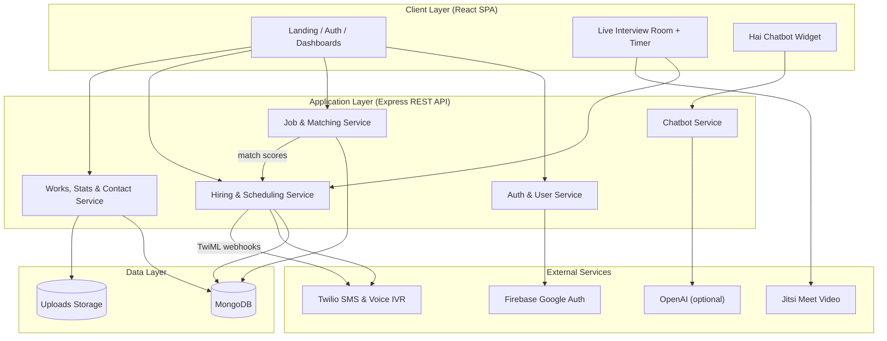
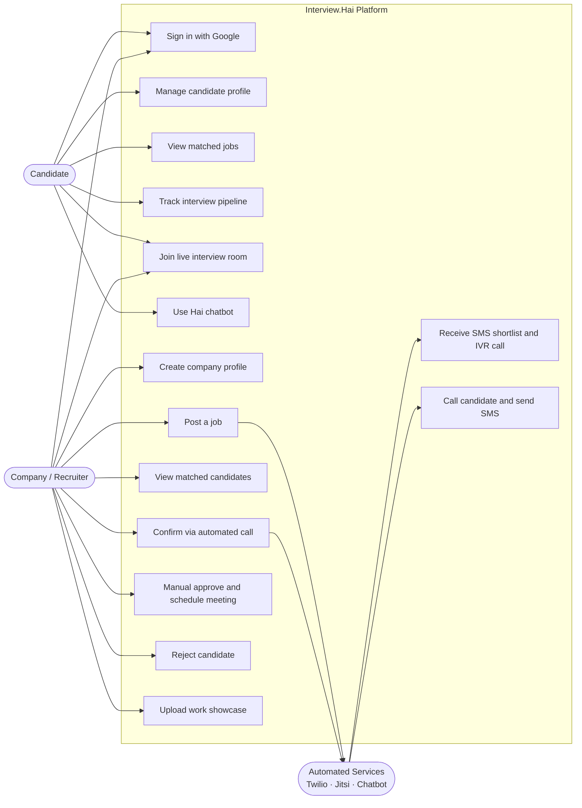
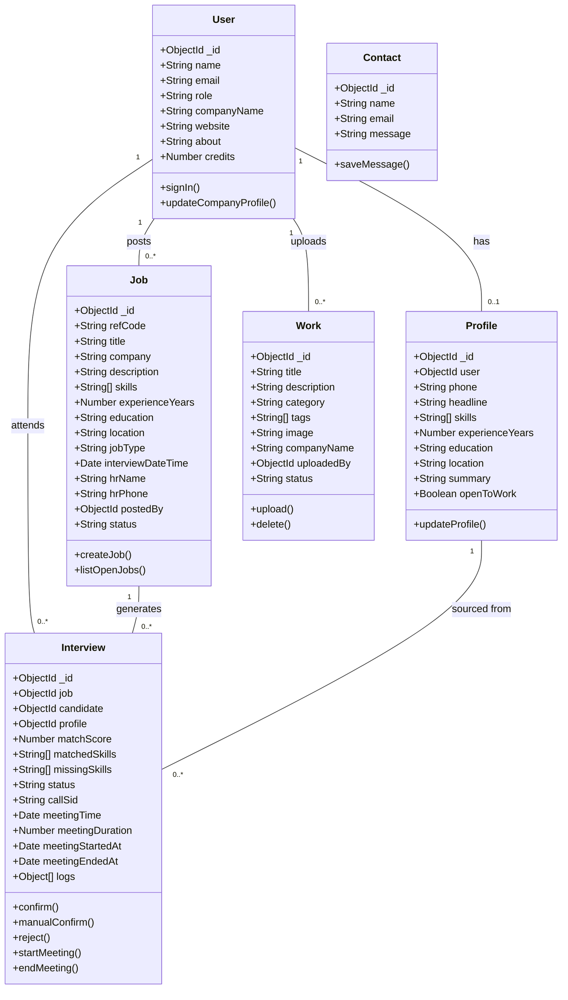
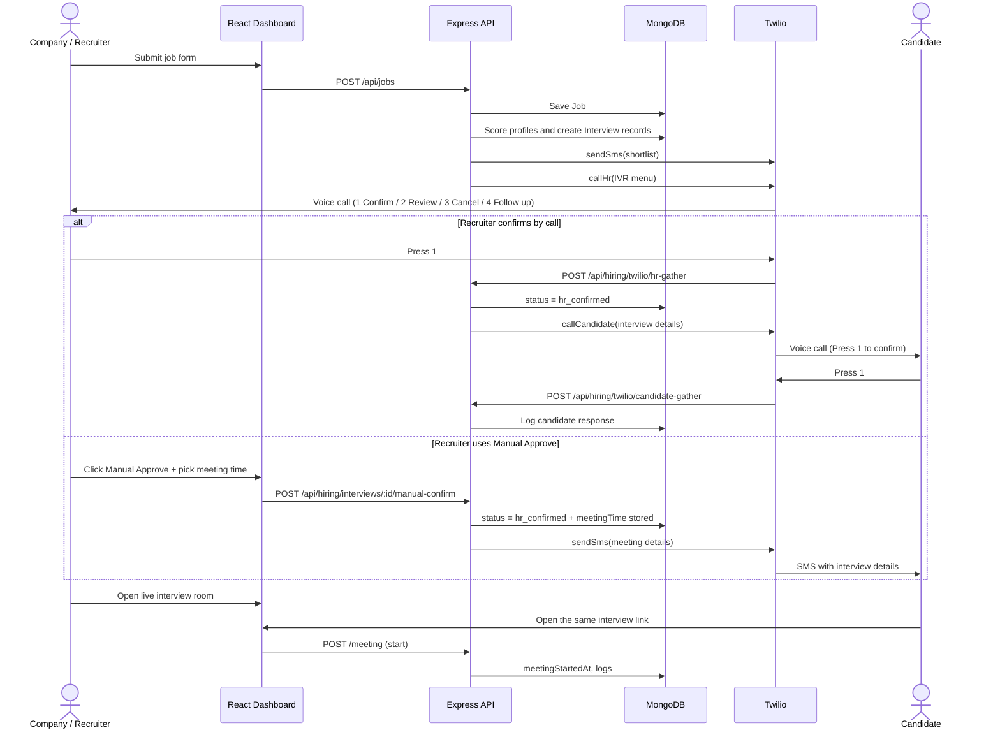
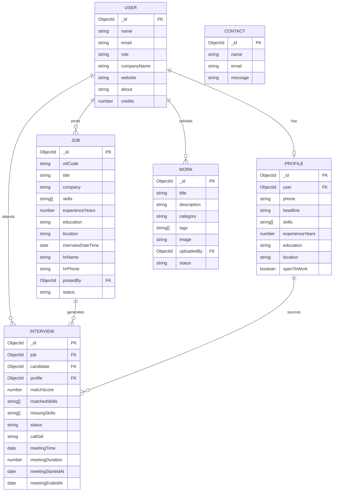
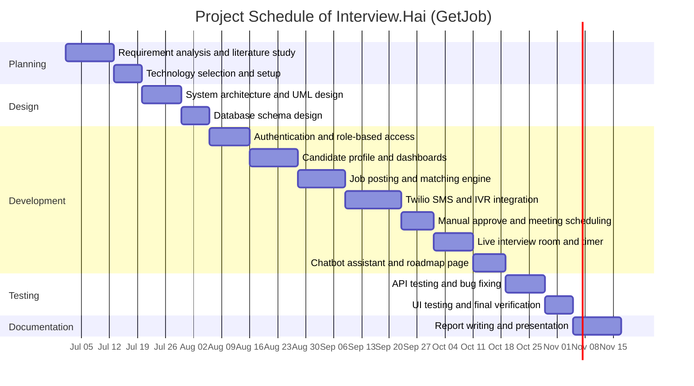

# A Mini Project Report on

# Interview.Hai (GetJob) — AI-Assisted Interview Matching and Automated Scheduling System

Submitted in partial fulfillment of the requirements of the degree of

## BACHELOR OF ENGINEERING

In

## INFORMATION TECHNOLOGY

by

**Anurudh Singh (GR No.243147)**
**Anshika Tiwari (GR No.243151)**
**Abhishek Yadav (GR No.243152)**
**Mansi Yadav (GR No.233152)**

Under the guidance of

**Prof. [Guide Name]**

Department of Information Technology Engineering
Theem College of Engineering, Boisar
Boisar Chilhar Road, Boisar (E), Palghar

University of Mumbai
2026-2027

---

# CERTIFICATE

This is to certify that the T.E. Mini project entitled **Interview.Hai (GetJob) — AI-Assisted Interview Matching and Automated Scheduling System** is a bonafide work of **Anurudh Singh (GR No.243147)**, **Anshika Tiwari (GR No.243151)**, **Abhishek Yadav (GR No.243152)**, **Mansi Yadav (GR No.233152)** submitted to the University of Mumbai in partial fulfillment of the requirement for the award of the degree of Information Technology Engineering during the academic year 2026-27.

<br><br><br>

**Prof. [Guide Name]**
Subject Incharge

<br><br>

**Prof. Sneha Sankhe** &nbsp;&nbsp;&nbsp;&nbsp;&nbsp;&nbsp;&nbsp;&nbsp;&nbsp;&nbsp;&nbsp;&nbsp;&nbsp;&nbsp;&nbsp;&nbsp; **Dr. Riyazoddin S.**
&nbsp;&nbsp;&nbsp;&nbsp;&nbsp; HOD IT &nbsp;&nbsp;&nbsp;&nbsp;&nbsp;&nbsp;&nbsp;&nbsp;&nbsp;&nbsp;&nbsp;&nbsp;&nbsp;&nbsp;&nbsp;&nbsp;&nbsp;&nbsp;&nbsp;&nbsp;&nbsp;&nbsp;&nbsp;&nbsp;&nbsp;&nbsp;&nbsp;&nbsp;&nbsp;&nbsp;&nbsp;&nbsp; Principal

---

# T.E. Mini Project Report Approval

This Mini project synopsis entitled **Interview.Hai (GetJob) — AI-Assisted Interview Matching and Automated Scheduling System** by **Anurudh Singh**, **Anshika Tiwari**, **Abhishek Yadav**, **Mansi Yadav** approved for the degree of Information Technology Engineering from University of Mumbai.

<br><br><br><br><br>

**INTERNAL EXAMINER** &nbsp;&nbsp;&nbsp;&nbsp;&nbsp;&nbsp;&nbsp;&nbsp;&nbsp;&nbsp;&nbsp;&nbsp;&nbsp;&nbsp;&nbsp;&nbsp;&nbsp;&nbsp;&nbsp;&nbsp;&nbsp;&nbsp;&nbsp;&nbsp;&nbsp;&nbsp;&nbsp;&nbsp;&nbsp;&nbsp;&nbsp;&nbsp;&nbsp;&nbsp;&nbsp;&nbsp; **EXTERNAL EXAMINER**

Date:
Place:

---

# Declaration

We declare that this written submission represents our ideas in their own words and where others' ideas or words have been included. We have adequately cited and referenced the original sources. We also declare that we have adhered to all principles of academic honesty and integrity and have not misrepresented or fabricated or falsified any idea/data/fact/source in our submission. We understand that any violation of the above will be cause for disciplinary action by the Institute and can also evoke penal action from the sources which have thus not been properly cited or from whom proper permission has not been taken when needed.

<br><br><br>

--------------------------------------------
**Anurudh Singh (GR No.243147)**

&nbsp;&nbsp;&nbsp;&nbsp;&nbsp;&nbsp;&nbsp;&nbsp;&nbsp;&nbsp;&nbsp;&nbsp;&nbsp;&nbsp;&nbsp;&nbsp;&nbsp;&nbsp;&nbsp;&nbsp;&nbsp;&nbsp;&nbsp;&nbsp;&nbsp;&nbsp;&nbsp;&nbsp;&nbsp;&nbsp;&nbsp;&nbsp;&nbsp;&nbsp;&nbsp;&nbsp;&nbsp;&nbsp;&nbsp;&nbsp;&nbsp;&nbsp;&nbsp;&nbsp;&nbsp;&nbsp;&nbsp;&nbsp; --------------------------------------------
&nbsp;&nbsp;&nbsp;&nbsp;&nbsp;&nbsp;&nbsp;&nbsp;&nbsp;&nbsp;&nbsp;&nbsp;&nbsp;&nbsp;&nbsp;&nbsp;&nbsp;&nbsp;&nbsp;&nbsp;&nbsp;&nbsp;&nbsp;&nbsp;&nbsp;&nbsp;&nbsp;&nbsp;&nbsp;&nbsp;&nbsp;&nbsp;&nbsp;&nbsp;&nbsp;&nbsp;&nbsp;&nbsp;&nbsp;&nbsp;&nbsp;&nbsp;&nbsp;&nbsp;&nbsp;&nbsp;&nbsp;&nbsp; **Anshika Tiwari (GR No.243151)**

--------------------------------------------
**Abhishek Yadav (GR No.243152)**

&nbsp;&nbsp;&nbsp;&nbsp;&nbsp;&nbsp;&nbsp;&nbsp;&nbsp;&nbsp;&nbsp;&nbsp;&nbsp;&nbsp;&nbsp;&nbsp;&nbsp;&nbsp;&nbsp;&nbsp;&nbsp;&nbsp;&nbsp;&nbsp;&nbsp;&nbsp;&nbsp;&nbsp;&nbsp;&nbsp;&nbsp;&nbsp;&nbsp;&nbsp;&nbsp;&nbsp;&nbsp;&nbsp;&nbsp;&nbsp;&nbsp;&nbsp;&nbsp;&nbsp;&nbsp;&nbsp;&nbsp;&nbsp; --------------------------------------------
&nbsp;&nbsp;&nbsp;&nbsp;&nbsp;&nbsp;&nbsp;&nbsp;&nbsp;&nbsp;&nbsp;&nbsp;&nbsp;&nbsp;&nbsp;&nbsp;&nbsp;&nbsp;&nbsp;&nbsp;&nbsp;&nbsp;&nbsp;&nbsp;&nbsp;&nbsp;&nbsp;&nbsp;&nbsp;&nbsp;&nbsp;&nbsp;&nbsp;&nbsp;&nbsp;&nbsp;&nbsp;&nbsp;&nbsp;&nbsp;&nbsp;&nbsp;&nbsp;&nbsp;&nbsp;&nbsp;&nbsp;&nbsp; **Mansi Yadav (GR No.233152)**

Date:

---

# Abstract

**Interview.Hai (GetJob) — AI-Assisted Interview Matching and Automated Scheduling System** is designed to make the hiring and interview-scheduling process faster, transparent and fully automated. The system helps candidates build a skill-based profile, discover matching job openings and track their interview pipeline, while companies post roles, receive automatically ranked candidate shortlists and confirm interviews without manual back-and-forth. It uses a multi-factor matching engine that scores every open candidate against a job using skills, experience, education and location, and explains the score with matched and missing skills. The platform supports automated recruiter notifications through Twilio SMS and Interactive Voice Response (IVR) calls, where the recruiter confirms or rejects the shortlist using keypad inputs. After confirmation, the candidate receives an automated call and SMS containing the interview details. A Manual Approve workflow lets recruiters confirm an interview directly from the dashboard and schedule the meeting date and time. The system also provides a live video interview room with an embedded video call, screen sharing and a countdown timer, along with separate candidate and company dashboards, a company work showcase, public statistics, a floating AI-style chatbot assistant and a product roadmap with learning resources. The platform is developed using React.js, Node.js, Express.js and MongoDB, with Redux Toolkit for state management, Firebase Google authentication, JSON Web Tokens for sessions, and Twilio and Jitsi Meet for communication services. Interview.Hai reduces scheduling delays, improves candidate visibility, removes manual coordination effort and provides a reliable, data-driven interview management experience.

**Keywords** – Interview.Hai, GetJob, AI Hiring, Job Matching, Candidate Shortlisting, Interview Scheduling, Twilio SMS, Interactive Voice Response, Manual Approve, Live Video Interview, Screen Sharing, Countdown Timer, MERN Stack, MongoDB.

---

The organization of this report is as follows.

**Chapter 1: Introduction**
This chapter gives a brief introduction about Interview.Hai (GetJob) furthermore includes Motivation, Problem Definition, Aim and Scope of the project.

**Chapter 2: Literature Review**
This chapter presents the study of existing recruitment, resume-matching and interview-scheduling systems and research papers to understand different technologies, matching methods, and automation approaches used in the project. It helps in identifying gaps, challenges, and improvements required for developing an automated and reliable interview-scheduling system.

**Chapter 3: System Architecture and Design**
This chapter provides implementation details of the project in system design which gives information about the necessary things required for project implementation. It also provides information regarding the proposed system architecture to understand the project.

**Chapter 4: System Design**
This chapter presents diagrams like UML and E.R. diagrams to understand connectivity and flow of various activities.

**Chapter 5: Results and Discussion**
This chapter presents screenshots of the system and discussion on working to understand various activities.

**Chapter 6: Conclusion and Future scope**
This chapter presents the lessons learned represented with the conclusion and the area where work can be further carried out in future represented with future scope.

---

# List of Contents

| Sr. No. | Contents | Page No. |
|---|---|---|
| | List of contents | i |
| | List of Figures | iii |
| | List of Tables | iv |
| | Abbreviations | v |
| | **Chapter - 1 Introduction** | |
| 1.1 | An overview | 1 |
| 1.2 | Motivation | 2 |
| 1.3 | Problem Definition | 2 |
| 1.4 | Aim of Project | 2 |
| 1.5 | Scope of Project | 2 |
| | **Chapter - 2 Literature Review** | |
| 2.1 | Documentary analysis | 4 |
| 2.2 | Comparative Study Table | 6 |
| | **Chapter - 3 System Architecture and Design** | |
| 3.1 | Introduction | 7 |
| 3.2 | Design | 8 |
| 3.3 | Requirement Analysis | 8 |
| 3.3.1 | Hardware Requirement | 8 |
| 3.3.2 | Software Requirement | 9 |
| 3.4 | Proposed System with Block Diagram | 9 |
| | **Chapter - 4 System Design** | |
| 4.1 | UML Diagrams | 11 |
| 4.1.1 | Use Case Diagram | 12 |
| 4.1.2 | Class Diagram | 13 |
| 4.1.3 | Sequence Diagram | 13 |
| 4.2 | ER Model | 14 |
| 4.3 | Gantt Chart | 15 |
| | **Chapter - 5 Result and Discussion** | |
| 5.1 | Implementation | 16 |
| 5.1.1 | Pseudo Code | 17 |
| 5.2 | Results | 24 |
| 5.2.1 | Landing Page | 24 |
| 5.2.2 | Sign in / Sign up Page | 25 |
| 5.2.3 | Candidate Dashboard | 26 |
| 5.2.4 | Company Dashboard | 26 |
| 5.2.5 | Post Job Page | 27 |
| 5.2.6 | Manual Approve | 27 |
| 5.2.7 | Live Interview Room | 28 |
| 5.2.8 | Roadmap and Learning Resources | 28 |
| 5.2.9 | Hai Chatbot Assistant | 29 |
| 5.3 | Testing Summary | 29 |
| | **Chapter - 6 Conclusion and Future Scope** | 30 |
| | References | 32 |
| | Acknowledgement | 33 |

---

# List of Figures

| Sr. No. | Figures | Page No. |
|---|---|---|
| Fig. 3.1 | System Architecture of Interview.Hai | 19 |
| Fig. 4.1 | Use Case Diagram | 21 |
| Fig. 4.2 | Class Diagram | 22 |
| Fig. 4.3 | Sequence Diagram | 23 |
| Fig. 4.4 | ER Diagram | 25 |
| Fig. 4.5 | Gantt Chart | 26 |
| Fig. 5.1 | Landing Page | 33 |
| Fig. 5.2 | Sign in / Sign up Page | 33 |
| Fig. 5.3 | Candidate Dashboard | 33 |
| Fig. 5.4 | Company Dashboard | 33 |
| Fig. 5.5 | Post Job Page | 34 |
| Fig. 5.6 | Manual Approve Modal | 34 |
| Fig. 5.7 | Live Interview Room | 34 |
| Fig. 5.8 | Roadmap and Learning Resources | 34 |
| Fig. 5.9 | Hai Chatbot Assistant | 35 |

---

# List of Tables

| Sr. No. | Tables | Page No. |
|---|---|---|
| Table 2.1 | Comparative Study Table | 16 |
| Table 3.1 | Hardware Requirement | 18 |
| Table 3.2 | Software Requirement | 18 |
| Table 5.1 | Testing Summary | 36 |

---

# Abbreviations

- **AI** – Artificial Intelligence
- **API** – Application Programming Interface
- **ATS** – Applicant Tracking System
- **CRUD** – Create, Read, Update, Delete
- **CSS** – Cascading Style Sheets
- **ER** – Entity-Relationship
- **HR** – Human Resources
- **HTML** – HyperText Markup Language
- **HTTP** – Hypertext Transfer Protocol
- **IVR** – Interactive Voice Response
- **JSON** – JavaScript Object Notation
- **JWT** – JSON Web Token
- **MERN** – MongoDB, Express.js, React.js, Node.js
- **ML** – Machine Learning
- **MVC** – Model-View-Controller
- **REST** – Representational State Transfer
- **SMS** – Short Message Service
- **SPA** – Single Page Application
- **TwiML** – Twilio Markup Language
- **UI** – User Interface
- **UML** – Unified Modeling Language
- **UX** – User Experience

---

# Chapter 1
# Introduction

## 1.1 An overview

**Interview.Hai (GetJob)** is an AI-assisted hiring platform designed to connect candidates and companies through skill-based matching and automated interview scheduling. The system considers factors such as the candidate's skills, experience, education, location and availability, and compares them against the requirements of each open job to produce an explainable match score. Candidates create a profile, set their "open to work" status and receive matched roles on their personal dashboard. Companies post job openings with required skills, experience, education, location and interview date; the system immediately scores all eligible candidates and presents the ranked shortlist on the company dashboard.

The platform automates recruiter communication using Twilio SMS and Interactive Voice Response (IVR) calls. Recruiters receive a shortlist by SMS and an automated voice call with a keypad menu that allows them to confirm, request human review, cancel or schedule a follow-up. On confirmation, selected candidates receive an automated call and SMS containing the interview details. Recruiters can also use the Manual Approve workflow to confirm an interview directly from the dashboard and set the meeting date and time without placing a call. In addition, the system provides a live video interview room with an embedded video call, screen sharing and a countdown timer; a company work showcase that appears on the public landing page; public statistics; a floating chatbot assistant that answers questions about matching, job posting and scheduling; and a roadmap page with learning resources. The platform is developed using React.js, Node.js, Express.js and MongoDB, providing a single, efficient and data-driven interview management solution.

## 1.2 Motivation

The motivation behind Interview.Hai is the amount of manual effort involved in shortlisting candidates and coordinating interview slots. Recruiters often screen applications manually, exchange multiple emails or messages to fix a time, and lose suitable candidates when replies are delayed. Candidates, on the other hand, have little visibility into which roles they match, why they were shortlisted, and when their interview is scheduled. These gaps increase hiring time, cause missed interviews and reduce trust in the process.

Interview.Hai is developed to address these challenges by combining explainable skill-based matching with automated SMS and voice-call notifications, so the shortlist and confirmation happen without manual follow-up. The Manual Approve workflow gives recruiters a direct control path when a call is inconvenient, and the live interview room with a timer brings the interview itself into the same platform. The system aims to reduce coordination delays, improve candidate visibility, prevent missed interviews and provide a more reliable hiring experience.

## 1.3 Problem Definition

Companies often manage candidate shortlisting and interview scheduling using spreadsheets, email threads and manual phone calls. This makes the process slow and error-prone: suitable candidates may not be contacted in time, recruiters may lose track of pending interviews, and candidates may not know the exact interview slot. There is also no common place where candidates can see why they matched a role and where recruiters can review the full matched pipeline.

Therefore, there is a need for a system that can automatically match candidates to jobs, notify recruiters through SMS and automated calls, record their decisions, confirm interview slots with candidates, and provide a shared live interview environment. Interview.Hai aims to solve this problem by automating the complete flow from job posting and candidate matching to interview confirmation, manual approval, meeting scheduling and live video interviews.

## 1.4 Aim of Project

The aim of Interview.Hai (GetJob) is to develop an intelligent platform that helps companies identify suitable candidates and schedule interviews automatically, while giving candidates a transparent view of their matches and interview status. The system aims to:

- Match candidates to jobs using skills, experience, education and location.
- Notify recruiters via SMS and automated IVR calls and capture their decisions.
- Confirm interviews with candidates through automated calls and SMS.
- Provide a Manual Approve option to confirm and schedule interviews directly.
- Offer a live video interview room with a countdown timer and screen sharing.
- Reduce manual coordination, missed interviews and scheduling delays.

## 1.5 Scope of Project

The scope of Interview.Hai includes developing a web-based platform with separate candidate and company dashboards. Candidates can create and update a profile, browse matched jobs, track their interview pipeline and enter the live interview room. Companies can post jobs, upload a work showcase, review matched candidates, confirm interviews via automated call or manual approval, and join the live interview room. The system provides automated matching and scoring, Twilio SMS and IVR communication, meeting scheduling, a countdown timer, a chatbot assistant and public statistics.

The project covers the complete interview-scheduling workflow but does not include payroll processing, background verification, digital offer signing, native mobile applications or integration with third-party Applicant Tracking Systems. Live telephone calls require valid Twilio credentials and an approved Twilio account; without credentials the system operates in a logged dry-run mode.

---

# Chapter 2
# Literature Review

## 2.1. Documentary analysis

**[1] Learning to Match Jobs with Resumes from Sparse Interaction Data using Multi-View Co-Teaching Network**
The paper "Learning to Match Jobs with Resumes from Sparse Interaction Data using Multi-View Co-Teaching Network" by Y. Luo, H. Zhang, Y. Wen and X. Zhang, published in EMNLP in 2020, focuses on learning job–resume matching from sparse interaction data. It aims to improve matching quality by combining multiple views of resumes and job descriptions using a co-teaching network, which is relevant to skill-based candidate scoring.

**[2] ConFit: Improving Resume-Job Matching using Data Augmentation and Contrastive Learning**
The paper "ConFit: Improving Resume-Job Matching using Data Augmentation and Contrastive Learning" by X. Yu, J. Zhang and Z. Yu, published at ACM RecSys in 2024, focuses on improving resume–job matching with data augmentation and contrastive learning. It aims to learn better representations of resumes and job descriptions so that relevant pairs are ranked higher, which supports explainable shortlist generation.

**[3] An Enhanced Neural Network Approach to Person-Job Fit in Talent Recruitment**
The paper by C. Qin, H. Zhu, T. Xu, C. Zhu, C. Ma, E. Chen and H. Xiong, published in ACM Transactions on Information Systems in 2020, proposes a topic-based ability-aware neural network for person–job fit. It models the importance of job requirements and candidate experience while improving interpretability, which is relevant to the skill-based scoring and matched/missing skill explanation used in Interview.Hai.

**[4] Resume Screening Using Natural Language Processing and Machine Learning: A Systematic Review**
The systematic review by A. K. Sinha, Md. A. K. Akhtar and A. Kumar, published in Springer's *Machine Learning and Information Processing* in 2021, examines resume parsing and screening techniques based on NLP and machine learning. It discusses semantic search, information extraction and research challenges, and motivates transparent, skill-based shortlisting with human oversight.

**[5] The Future of Recruitment: Using Deep Learning to Build Intelligent Interview Bots**
The paper by S. Ahmad, S. Hussain, M. Wasid, J. O. Ogala, M. Arif and J. Ahmad, published at the 2024 International Conference on Computing, Communication and Networking Technologies (ICCCNT), explores an NLP-based solution that automates interview scheduling and communication. It shows how automation can reduce manual coordination and human error, which directly relates to the Twilio-based notification, IVR confirmation and scheduling workflow implemented in this project.

## 2.2. Comparative Study Table

**Table 2.1. Comparative Study Table**

| Sr. No. | Title of the Paper | Publication Year | Author Name | Limitations |
|---|---|---|---|---|
| 1 | Learning to Match Jobs with Resumes from Sparse Interaction Data using Multi-View Co-Teaching Network | 2020 | Y. Luo, H. Zhang, Y. Wen, X. Zhang | Requires historical interaction data; explainability of the match to candidates and recruiters is limited. |
| 2 | ConFit: Improving Resume-Job Matching using Data Augmentation and Contrastive Learning | 2024 | X. Yu, J. Zhang, Z. Yu | Focused on ranking quality; does not automate interview scheduling or recruiter confirmation. |
| 3 | An Enhanced Neural Network Approach to Person-Job Fit in Talent Recruitment | 2020 | C. Qin, H. Zhu, T. Xu, C. Zhu, C. Ma, E. Chen, H. Xiong | Needs historical application data; no scheduling, communication or live interview workflow. |
| 4 | Resume Screening Using Natural Language Processing and Machine Learning: A Systematic Review | 2021 | A. K. Sinha, Md. A. K. Akhtar, A. Kumar | Reviews screening in isolation; missing communication, scheduling and live interview support. |
| 5 | The Future of Recruitment: Using Deep Learning to Build Intelligent Interview Bots | 2024 | S. Ahmad, S. Hussain, M. Wasid, J. O. Ogala, M. Arif, J. Ahmad | Focused on interview automation; no explainable skill matching, dashboard pipeline or manual approval. |

---

# Chapter 3
# System Architecture and Design

## 3.1 Introduction

The System Architecture and Design of Interview.Hai describes how the different components of the system interact with each other. The system consists of a React-based user interface, an Express backend server, a MongoDB database, a matching engine, communication services (Twilio SMS and voice), a live video service (Jitsi Meet) and an optional chatbot service. The candidate or company provides input through the interface, the backend processes the request, the matching engine scores candidates, and the communication services deliver notifications and capture decisions. This architecture provides a structured and efficient way to manage job posting, matching, interview confirmation and live interviews.

## 3.2 Design

The design of Interview.Hai follows a modular architecture consisting of the Frontend, Backend, Database, Matching Module, Communication Module and External Services. The frontend allows candidates and companies to register, manage profiles, post jobs, review candidates and join the interview room. The backend processes requests and manages application logic, while MongoDB stores user, profile, job, interview, work and contact data. The matching module computes explainable match scores. The communication module sends SMS and places IVR calls through Twilio and validates webhook signatures. Jitsi Meet provides the live video room, while the chatbot answers platform questions using rule-based intents or an optional AI provider.

## 3.3 Requirement Analysis

The Interview.Hai system requires a user-friendly platform that allows users to sign in with Google, choose a candidate or company role, create profiles, post jobs, view matched candidates, confirm interviews and join live interview rooms. The system should automatically match candidates to jobs, notify recruiters by SMS and automated call, record recruiter decisions, confirm interviews with candidates and support manual approval with meeting scheduling. It should also provide a live video room with a timer, a chatbot assistant and public statistics. The system must be secure, reliable, scalable, fast and easy to use.

### 3.3.1 Hardware Requirements

**Table 3.1. Hardware Requirements**

| Component | Requirement |
|---|---|
| Processor | Core 2 Duo (2.6 GHz) or higher |
| Hard Disk | 50 GB or higher |
| RAM | 4 GB minimum (8 GB recommended) |
| Internet Connection | 10 Mbps minimum |
| Camera and Microphone | Required only for live video interviews |

### 3.3.2 Software Requirements

**Table 3.2. Software Requirements**

| Component | Requirement |
|---|---|
| Operating System | Windows / Linux / macOS |
| Programming Language | JavaScript (React.js, Node.js), HTML, CSS |
| Frontend Framework | React.js, Vite, Tailwind CSS, Redux Toolkit |
| Backend Framework | Node.js, Express.js |
| Database | MongoDB (Mongoose ODM) |
| Authentication | Firebase Google Sign-In, JSON Web Token |
| Communication APIs | Twilio Programmable SMS and Programmable Voice |
| Video Service | Jitsi Meet (embedded room) |
| API Testing | Postman / PowerShell Invoke-WebRequest |
| Version Control | Git and GitHub |
| Programming Tool | Visual Studio Code |

## 3.4 Proposed System with Block Diagram

The proposed Interview.Hai system is a smart web-based application designed to automate candidate matching and interview scheduling. The system begins with Google-based registration and login, after which the user is identified as a candidate or a company. A candidate creates a profile containing skills, experience, education, location and phone number. A company posts a job containing the required skills, experience, education, location, interview date and recruiter phone number. The matching engine scores every eligible candidate and stores the match result with matched and missing skills. The company receives an SMS shortlist and an automated IVR call with keypad options, and can also confirm an interview manually from the dashboard by selecting a meeting date and time. On confirmation, the candidate is notified by an automated call and SMS, and both participants can join the live video interview room, where the session is tracked with a countdown timer. All job, candidate, interview and work data is stored in MongoDB, and public statistics and the company work showcase are displayed on the landing page.



**Fig 3.1 System Architecture of Interview.Hai (GetJob) — AI-Assisted Interview Matching and Automated Scheduling System**

---

# Chapter 4
# System Design

## 4.1 UML Diagrams

The proposed Interview.Hai system is represented using Use Case, Class and Sequence diagrams. These diagrams illustrate user interactions, system structure and the workflow of job posting, candidate matching, recruiter notification, interview confirmation, manual approval and live interviews. They also explain the relationships between different system components and the sequence of operations performed by candidates, companies and automated services. Together, these diagrams help in understanding the overall design, functionality and behaviour of the proposed system.

### 4.1.1 Use Case Diagram

The Use Case Diagram illustrates the interactions between the Candidate, the Company/Recruiter and the automated Communication Service within Interview.Hai. The Candidate can sign in with Google, create and update a profile, view matched jobs, track the interview pipeline, join the live interview room and use the chatbot. The Company can sign in, create a company profile, post jobs, upload work, view matched candidates, confirm interviews by automated call, manually approve and schedule meetings, reject candidates and join the live room. The system also supports automated matching, SMS shortlist delivery, IVR confirmation calls, candidate notification calls, meeting-time recording, timer management, access control for the interview room, stats aggregation and chatbot responses. This diagram provides a clear overview of the system's functional requirements and defines the responsibilities of each actor.



**Fig 4.1 Use Case Diagram of Interview.Hai (GetJob)**

### 4.1.2 Class Diagram

The Class Diagram illustrates the structure of Interview.Hai, including its classes, attributes, methods and relationships. The key classes include User, Profile, Job, Interview, Work and Contact. These classes handle authentication and roles, candidate details, job requirements, matching and scheduling state, work-showcase uploads, and contact messages. The relationships between these classes define how a company posts jobs, how candidates are matched and how interviews progress through their lifecycle.



**Fig 4.2 Class Diagram of Interview.Hai (GetJob)**

### 4.1.3 Sequence Diagram

The Sequence Diagram shows the complete automated flow from job posting to interview confirmation. The company posts a job, the server matches candidates and stores interview records, Twilio sends an SMS shortlist and places an IVR call to the recruiter, the recruiter presses a keypad option, the server confirms the shortlist and places a confirmation call to the candidate, and the candidate presses a key to accept. The same diagram also applies when the recruiter chooses Manual Approve from the dashboard instead of the call.



**Fig 4.3 Sequence Diagram of Interview.Hai (GetJob)**

## 4.2 ER Model

Interview.Hai is supported by a structured database model represented by an Entity-Relationship (ER) diagram, consisting of key entities such as User, Profile, Job, Interview, Work and Contact. Each entity contains relevant attributes, with unique primary keys used to identify records and foreign keys used to establish relationships between entities. The User entity stores the name, email and role, along with company details for recruiter accounts. The Profile entity stores the candidate's phone, headline, skills, experience, education, location and open-to-work status. The Job entity stores the reference code, title, company, required skills, experience, education, location, interview date and recruiter contact. The Interview entity records the matched job and candidate, match score, matched and missing skills, status, call identifiers, the scheduled meeting time, meeting duration and meeting start and end timestamps. The Work entity stores company showcase items with images and tags, while the Contact entity stores messages submitted through the contact form. These entities and their relationships ensure data consistency, efficient matching, reliable scheduling and secure access to interview rooms.



**Fig 4.4 ER Diagram of Interview.Hai (GetJob)**

## 4.3 Gantt Chart

The Gantt chart for Interview.Hai represents the project schedule, including the major development phases, tasks and their estimated duration. It illustrates the planning and execution of requirements analysis, system design, database development, authentication, candidate and company dashboards, the matching engine, Twilio SMS and IVR integration, manual approval and meeting scheduling, the live interview room and timer, the chatbot assistant, testing and documentation. The chart helps monitor project progress, manage time effectively and ensure timely completion of the project.



**Fig 4.5 Gantt Chart of Interview.Hai (GetJob)**

---

# Chapter 5
# Results and Discussion

## 5.1 Implementation

Interview.Hai (GetJob) is developed to help companies match candidates to jobs and schedule interviews automatically, while giving candidates a transparent view of their matches and interviews.

The frontend is developed using React.js, Vite, Tailwind CSS and Motion for animations, with Redux Toolkit for user state and React Router for navigation. It provides an animated landing page, role-aware navigation, candidate and company dashboards, job posting, profile management, a live interview room and a floating chatbot. The backend uses Node.js and Express.js to handle API requests, authentication, matching, hiring, works, statistics and chatbot services. MongoDB is used to store users, profiles, jobs, interviews, works and contact messages.

The system includes an explainable matching engine that scores candidates using skills, experience, education and location, and stores matched and missing skills. Twilio SMS and IVR calls automate recruiter notifications and candidate confirmations, while the Manual Approve workflow allows direct confirmation with meeting-time scheduling. The live interview room embeds a Jitsi video call with screen sharing, a countdown timer, invite-link copying and access control limited to the candidate and the hiring company. Security includes Google authentication, an httpOnly JWT session cookie, Twilio webhook signature validation and role-based route protection. The chatbot answers platform questions using rule-based intents, with optional OpenAI support when an API key is configured.

### 5.1.1. Pseudo Code

**1. SERVER INITIALIZATION**

```
FUNCTION startServer():
    LOAD environment variables (.env)
    connect MongoDB (MONGODB_URL)
    start Express REST API on PORT (default 8000)
    ENABLE CORS for http://localhost:5173 with credentials
    PARSE JSON bodies and cookies
    mount routes: auth, user, jobs, hiring,
                  stats, works, contact, chatbot
    SERVE /uploads as static files
    log "Server is running on the port"
```

**2. AUTHENTICATION (FIREBASE + JWT)**

```
FUNCTION googleSignIn(idToken, role):
    verify Firebase ID token
    user = find User by email
    IF not found:
        CREATE User { name, email, role }
    ELSE IF role differs:
        UPDATE user.role
    token = JWT.sign({ id, role }, JWT_SECRET, expiresIn = 7d)
    SET httpOnly cookie (token, sameSite)
    RETURN user

MIDDLEWARE isAuth(request):
    token = request.cookies.token
    IF missing OR invalid → 401 Unauthorized
    attach userId to request
    CONTINUE

FUNCTION logout():
    CLEAR session cookie
    RETURN 200
```

**3. PROFILE MANAGEMENT**

```
FUNCTION saveCandidateProfile(userId, data):
    UPSERT Profile { user: userId }
    SET phone, headline, skills, experienceYears,
        education, location, summary, openToWork
    RETURN profile

FUNCTION saveCompanyProfile(userId, data):
    UPDATE User { companyName, website, about }
    RETURN updated user

FUNCTION getPublicStats():
    candidates = COUNT Users WHERE role = "candidate"
    jobs       = COUNT Jobs WHERE status = "active"
    matches    = COUNT Interviews
    confirmed  = COUNT Interviews WHERE status IN
                 ["hr_confirmed", "candidate_called"]
    RETURN { candidates, jobs, matches, confirmed }
```

**4. JOB POSTING AND MATCHING**

```
FUNCTION createJob(companyId, jobData):
    refCode = generateRefCode()          // 6 uppercase hex chars
    job = INSERT Job {
        refCode, title, company, description,
        skills, experienceYears, education,
        location, jobType, interviewDateTime,
        hrName, hrPhone, postedBy: companyId,
        status: "active"
    }
    matches = matchCandidatesForJob(job)
    NOTIFY recruiter asynchronously:
        sendSms(shortlist)
        callHr(IVR menu)
    RETURN { job, matches }

FUNCTION matchCandidatesForJob(job):
    profiles = FIND Profiles WHERE openToWork = true
    results = []
    FOR EACH profile IN profiles:
        score = matchProfileToJob(job, profile)
        // skill overlap + experience + education + location
        interview = UPSERT Interview {
            job: job._id,
            candidate: profile.user,
            profile: profile._id,
            matchScore: score.total,
            matchedSkills: score.matched,
            missingSkills: score.missing,
            status: "matched"
        }
        results.APPEND(interview)
    RETURN results sorted by matchScore DESC
```

**5. HR NOTIFICATION (SMS + IVR CALL)**

```
FUNCTION notifyHr(job, interviews):
    IF interviews is empty:
        RETURN { notified: false }

    lines = first 5 candidates formatted as
            "name - score% match (skills)"
    body = shortlist summary +
           "Press 1 to confirm, 2 review, 3 cancel, 4 follow up" +
           "Reply YES <refCode> / NO <refCode>"
    result = sendSms({ to: job.hrPhone, body })
    UPDATE interviews SET status = "hr_notified",
           hrSmsSid = result.sid, hrNotifiedAt = now
    RETURN result

FUNCTION callHrForJob(job, interviews):
    IF interviews is empty:
        RETURN { called: false }
    result = callHr({
        to: job.hrPhone,
        jobTitle, company,
        candidateCount: interviews.length,
        jobId: job._id
    })
    APPEND log "hr_called" to each interview
    RETURN result
```

**6. HR IVR WEBHOOK**

```
FUNCTION handleHrGather(request):
    VALIDATE Twilio signature
    job = FIND Job BY request.query.job
    IF not found → SAY "No active job found"
    pending = FIND Interviews WHERE job = job AND status IN
              ["matched", "hr_notified", "hr_confirmed",
               "human_review", "follow_up"]

    SWITCH request.body.Digits:
        CASE "1":
            results = confirmInterviews(pending)
            SAY "Confirmed. Calls placed."
        CASE "2":
            SET status = "human_review" for all pending
            SAY "Flagged for human review"
        CASE "3":
            SET status = "rejected" for all pending
            SAY "Shortlist cancelled"
        CASE "4":
            SET status = "follow_up" for all pending
            SAY "Follow up scheduled"
        DEFAULT:
            SAY "Invalid option"
    SAVE all updated interviews
```

**7. INTERVIEW CONFIRMATION AND CANDIDATE CALL**

```
FUNCTION confirmInterviews(interviews):
    results = []
    FOR EACH interview IN interviews:
        interview.status = "hr_confirmed"
        interview.hrRespondedAt = now
        APPEND log "hr_confirmed"
        SAVE interview

        result = callSelectedCandidate(interview)
        results.APPEND(result)
    RETURN results

FUNCTION callSelectedCandidate(interview):
    result = callCandidate({
        to: interview.profile.phone,
        candidateName, jobTitle, company,
        interviewDateTime, hrName, hrPhone
    })
    interview.status = "candidate_called"
    interview.callSid = result.sid
    interview.callStatus = result.status
    interview.candidateCalledAt = now
    APPEND log "candidate_called"
    SAVE interview
    RETURN result

FUNCTION handleCandidateGather(request):
    VALIDATE Twilio signature
    interview = FIND Interview BY callSid = request.body.CallSid
    SWITCH request.body.Digits:
        CASE "1": LOG "candidate_accepted"; SAY "Interview confirmed"
        CASE "2": SET status = "rejected"; SAY "Noted"
        CASE "3": SET status = "delayed"; SAY "Marked as delayed"
        CASE "4": SET status = "next_job"; SAY "Considered for next job"
    SAVE interview
```

**8. MANUAL APPROVE AND MEETING SCHEDULING**

```
FUNCTION manualConfirmInterview(interviewId, meetingTime):
    interview = FIND Interview BY id
    IF status IN ["rejected", "next_job"]:
        RETURN 400 "Cannot approve this candidate"

    IF meetingTime is provided AND invalid:
        RETURN 400 "Invalid meeting time"

    interview.status = "hr_confirmed"
    interview.hrRespondedAt = now
    IF meetingTime is provided:
        interview.meetingTime = meetingTime
    APPEND log "manual_confirmed"
    IF meetingTime is provided:
        APPEND log "meeting_scheduled"
    SAVE interview

    IF candidate phone is available:
        body = "Your interview for <role> at <company>
                has been confirmed. Interview: <meetingTime>"
        sendSms({ to: phone, body })
        APPEND log "candidate_sms"
        SAVE interview

    RETURN { message, interview }
```

**9. LIVE INTERVIEW ROOM AND TIMER**

```
FUNCTION getInterviewRoom(interviewId, userId):
    interview = FIND Interview BY id
                 POPULATE job, candidate, profile
    IF not found → 404
    IF userId ≠ interview.candidate
       AND userId ≠ interview.job.postedBy:
        RETURN 403 "You are not part of this interview"
    RETURN interview

FUNCTION updateMeetingStatus(interviewId, userId, action):
    CHECK access control (same as above)
    IF action = "start":
        interview.meetingStartedAt = now (first join only)
        APPEND log "meeting_joined"
    ELSE IF action = "end":
        interview.meetingEndedAt = now
        APPEND log "meeting_ended"
    SAVE interview
    RETURN meeting timestamps

CLIENT FUNCTION startTimer():
    IF remaining <= 0: reset to duration
    startedAt = Date.now()
    running = true
    STORE { startedAt } in localStorage
    POST /meeting { action: "start" }

CLIENT FUNCTION tick() EVERY 1 SECOND:
    remaining = duration - elapsed(startedAt)
    IF remaining <= 0:
        running = false
        CLEAR localStorage
        SHOW "Time up"

CLIENT FUNCTION joinCall():
    roomName = "interviewhai-" + interviewId
    url = "https://meet.jit.si/" + roomName +
          "#userInfo.displayName=<name>" +
          "&config.prejoinPageEnabled=false" +
          "&config.startWithAudioMuted=true"
    RENDER embedded iframe
    START timer automatically
```

**10. CHATBOT ASSISTANT**

```
FUNCTION chat(message):
    IF OPENAI_API_KEY is configured:
        reply = callOpenAI(systemPrompt, message)
        IF reply is valid:
            RETURN { reply, source: "ai" }

    text = normalize(message)
    bestIntent = null; bestScore = 0
    FOR EACH intent IN [greeting, matching, post_job,
                        manual_approve, call_flow, statuses,
                        candidate_help, interview_practice,
                        contact, privacy, thanks]:
        score = count keyword matches in text
        IF score > bestScore:
            bestScore = score; bestIntent = intent

    IF bestIntent is null:
        RETURN fallback help message
    RETURN bestIntent.reply
```

**11. WORKS SHOWCASE AND CONTACT**

```
FUNCTION uploadWork(companyId, formData, imageFile):
    VALIDATE title and file type (png/jpg/webp, max 5MB)
    imagePath = save file to /uploads
    work = INSERT Work {
        title, description, category, tags,
        image: imagePath, companyName,
        uploadedBy: companyId, status: "published"
    }
    RETURN work

FUNCTION getFeaturedWorks():
    RETURN latest 6 Works WHERE status = "published"

FUNCTION saveContactMessage(name, email, message):
    INSERT Contact { name, email, message }
    RETURN acknowledgement
```

## 5.2 Results

Interview.Hai successfully implements candidate registration, profile management, job posting, explainable candidate matching, automated recruiter notification, IVR confirmation, candidate confirmation calls, manual approval with meeting scheduling, live video interviews with a countdown timer, works showcase, statistics and a chatbot assistant. Functional verification achieved clean static analysis with 0 warnings and 0 errors across 28 frontend files, a successful production build, and passing API smoke tests for authentication, jobs, hiring, works and chatbot endpoints. The demo dataset used during verification contained 13 candidate profiles, 7 job postings, 18 interview matches and 7 confirmed interviews. Live telephone calls require approved Twilio credentials; without them the system stores and logs the SMS and call payloads in a dry-run mode.

### 5.2.1 Landing Page

The Interview.Hai landing page provides an introduction to the AI-assisted hiring platform. It presents the key features, including AI mock interviews, resume scanning, automatic recruiter notifications and interview matching. The page contains an animated hero section with floating preview cards, a features grid, a company work showcase, a step-by-step "how it works" section, live statistics, testimonials, and Login and Get Started buttons. Its responsive, light interface provides a simple and user-friendly experience across desktop and mobile devices.

*[Insert screenshot: Fig 5.1 Landing Page of Interview.Hai]*

### 5.2.2 Sign in / Sign up Page

The Sign in / Sign up page allows users to create an account or sign in securely using Google authentication. It supports selecting the Candidate role or the Company/Founder role, and it redirects each role to the appropriate dashboard after login. Session handling uses an httpOnly JWT cookie, and invalid or expired sessions are redirected back to this page.

*[Insert screenshot: Fig 5.2 Sign in / Sign up Page of Interview.Hai]*

### 5.2.3 Candidate Dashboard

The Candidate Dashboard provides an overview of the candidate's interview activity. It displays statistics such as roles matched, interviews confirmed, pending recruiter responses and remaining credits. It also shows the complete interview pipeline with status badges, the candidate profile summary with skills and experience, open jobs with match percentages, and a Live Interview section with actions to join or prepare an interview session.

*[Insert screenshot: Fig 5.3 Candidate Dashboard of Interview.Hai]*

### 5.2.4 Company Dashboard

The Company Dashboard provides a company profile panel, a work-upload form and gallery, and a matched-candidates section. Each matched candidate displays the match score, matched skills, phone number and current status. Pending candidates expose three actions: Confirm via Call, Manual Approve and Reject. Confirmed interviews display a Join Room button that opens the live interview room.

*[Insert screenshot: Fig 5.4 Company Dashboard of Interview.Hai]*

### 5.2.5 Post Job Page

The Post Job page allows a company to publish a role by entering the title, description, required skills, experience, education, location, job type, interview date and recruiter contact details. Submitting the form automatically triggers candidate matching and recruiter notification, and the new role becomes visible to matched candidates.

*[Insert screenshot: Fig 5.5 Post Job Page of Interview.Hai]*

### 5.2.6 Manual Approve

The Manual Approve modal opens from the Company Dashboard when a recruiter chooses to approve a candidate without an automated call. It shows the candidate details and provides a meeting date and time picker. Selecting "Approve & Notify" confirms the interview, stores the meeting date and time on the interview record, records the action in the interview log, and sends an SMS with the interview details to the candidate. The scheduled meeting time is then shown on the company and candidate dashboards and in the live interview room.

*[Insert screenshot: Fig 5.6 Manual Approve Modal of Interview.Hai]*

### 5.2.7 Live Interview Room

The Live Interview Room allows the candidate and the recruiter to join the same embedded video call with camera, microphone and screen sharing. The room shows a countdown timer with start, pause, resume and reset controls, a progress ring that warns as time runs out, interview details, participant information, a copy-invite-link action and a join-in-new-tab fallback. Access is restricted to the candidate and the hiring company.

*[Insert screenshot: Fig 5.7 Live Interview Room of Interview.Hai]*

### 5.2.8 Roadmap and Learning Resources

The Roadmap page presents the product roadmap, including AI mock interview expansion, learning resources, an enhanced matching algorithm and video interview integration. It also provides learning resources for candidates and companies, covering role-based question guides, resume and profile optimisation and hiring best practices.

*[Insert screenshot: Fig 5.8 Roadmap and Learning Resources of Interview.Hai]*

### 5.2.9 Hai Chatbot Assistant

The Hai chatbot assistant is available on every page as a floating widget. It answers questions about matching, job posting, Manual Approve, automated calls, interview statuses, support and privacy. It provides quick-reply suggestions, a typing indicator and graceful fallback responses. When an OpenAI API key is configured it answers with an AI model, otherwise it uses rule-based intent matching.

*[Insert screenshot: Fig 5.9 Hai Chatbot Assistant of Interview.Hai]*

## 5.3 Testing Summary

The testing of the Interview.Hai platform was carried out using tools such as Postman and PowerShell Invoke-WebRequest for API testing, MongoDB for database verification, oxlint for static analysis, Vite for production build verification, and manual browser testing for user flows. Testing focused on authentication, role-based navigation, profile management, job posting and matching, recruiter notification, IVR webhooks, manual approval, live room access control, the countdown timer, the works showcase and the chatbot.

**Tools Used**

**1. Postman / Invoke-WebRequest (API Testing)**
REST APIs were tested to verify request-response cycles and validate authentication, data retrieval, job posting, hiring actions, statistics and chatbot responses using GET and POST methods. Key APIs tested include:

- `/api/auth/google` – Google authentication and session creation
- `/api/user/current-user` – Session validation
- `/api/jobs` – Job listing and posting
- `/api/hiring/candidates` – Company matched candidates
- `/api/hiring/interviews/:id/manual-confirm` – Manual approval
- `/api/hiring/interviews/:id` – Live interview room access
- `/api/hiring/twilio/hr-gather` – IVR keypad webhook
- `/api/hiring/twilio/candidate-gather` – Candidate keypad webhook
- `/api/chatbot/chat` – Chatbot responses
- `/api/stats` – Public statistics

**2. MongoDB (Database Testing)**
MongoDB was used to verify data storage, retrieval and updates for users, profiles, jobs, interviews, works and contact messages. Database checks helped ensure data consistency, correct interview status transitions and accurate meeting timestamps.

**3. Static Analysis and Build Verification**
oxlint was executed across the frontend source files and reported zero warnings and zero errors. The Vite production build completed successfully, confirming that all modules, routes and assets resolve correctly.

**4. Manual Browser Testing**
Manual testing covered sign-in for both roles, dashboard navigation, profile updates, job posting, manual approval with meeting scheduling, chatbot conversations and the live interview room with timer controls. Access control was verified by confirming that an unrelated account receives a 403 response for the interview room API.

**Table 5.1. Testing Summary**

| Sr. No. | Test Case | Expected Result | Status |
|---|---|---|---|
| 1 | Google sign-in as Candidate / Company | Session created, correct dashboard shown | Passed |
| 2 | Role-aware navigation | Candidate and company see correct links | Passed |
| 3 | Profile create and update | Data saved and visible on dashboard | Passed |
| 4 | Post job triggers matching | Interview records created with match scores | Passed |
| 5 | HR SMS and IVR payload generation | SMS and TwiML generated (dry-run without Twilio keys) | Passed |
| 6 | Manual approve with meeting time | Status confirmed, meetingTime stored, SMS sent to candidate | Passed |
| 7 | Reject candidate | Status updated to rejected | Passed |
| 8 | Live room access control | Only candidate or hiring company allowed | Passed |
| 9 | Countdown timer start/pause/reset | Timer behaves correctly and persists on refresh | Passed |
| 10 | Chatbot responses | Correct intent reply or fallback | Passed |
| 11 | Static analysis (oxlint) | 0 warnings, 0 errors | Passed |
| 12 | Production build (Vite) | Build completes successfully | Passed |

This testing approach helped evaluate the functionality, reliability and consistency of Interview.Hai. Live telephone calls and two-participant video quality depend on external services and the network environment, and should be verified with approved Twilio credentials before deployment.

---

# Chapter 6
# Conclusion and Future Scope

Interview.Hai (GetJob) is developed to simplify the process of matching candidates to jobs and scheduling interviews. It helps companies identify suitable candidates using skills, experience, education and location, notify recruiters through SMS and automated IVR calls, confirm interviews through calls or manual approval, and conduct the interview in an embedded live video room with a countdown timer. Features such as explainable match scores, a shared interview pipeline, meeting scheduling, a work showcase, public statistics and a chatbot assistant improve transparency and user experience. The integration of React.js, Node.js, Express.js and MongoDB provides an efficient platform for managing users, profiles, jobs, interviews and company work.

In the future, Interview.Hai can be enhanced by implementing the full AI mock interview module with speech analysis and answer scoring, adding resume parsing and automatic profile extraction, and integrating calendar services for automatic meeting invites. The matching engine can be extended with learning-to-rank models trained on recruiter decisions, and the live interview room can add recording, transcripts and in-call notes. Further improvements can include multi-language IVR, email and WhatsApp notifications, mobile applications, analytics dashboards for hiring funnels and integration with external Applicant Tracking Systems. These enhancements can make Interview.Hai more reliable, efficient and user-friendly while supporting faster and fairer hiring.

---

# References

[1] Y. Luo, H. Zhang, Y. Wen, and X. Zhang, "Learning to Match Jobs with Resumes from Sparse Interaction Data using Multi-View Co-Teaching Network," in *Proceedings of EMNLP*, 2020.

[2] X. Yu, J. Zhang, and Z. Yu, "ConFit: Improving Resume-Job Matching using Data Augmentation and Contrastive Learning," in *Proceedings of the 18th ACM Conference on Recommender Systems (RecSys)*, 2024. doi: 10.1145/3640457.3688108.

[3] C. Qin, H. Zhu, T. Xu, C. Zhu, C. Ma, E. Chen, and H. Xiong, "An Enhanced Neural Network Approach to Person-Job Fit in Talent Recruitment," *ACM Transactions on Information Systems*, vol. 38, no. 2, Article 15, 2020. doi: 10.1145/3376927.

[4] A. K. Sinha, Md. A. K. Akhtar, and A. Kumar, "Resume Screening Using Natural Language Processing and Machine Learning: A Systematic Review," in *Machine Learning and Information Processing*, Advances in Intelligent Systems and Computing, vol. 1311, Springer, 2021, pp. 207–214. doi: 10.1007/978-981-33-4859-2_21.

[5] S. Ahmad, S. Hussain, M. Wasid, J. O. Ogala, M. Arif, and J. Ahmad, "The Future of Recruitment: Using Deep Learning to Build Intelligent Interview Bots," in *Proceedings of the International Conference on Computing, Communication and Networking Technologies (ICCCNT)*, IEEE, 2024. doi: 10.1109/ICCCNT61001.2024.10725310.

[6] Twilio Inc., "Programmable Messaging and Programmable Voice Documentation," Twilio Docs. [Online]. Available: https://www.twilio.com/docs

[7] MongoDB Inc., "MongoDB Manual," MongoDB Documentation. [Online]. Available: https://www.mongodb.com/docs

[8] Meta Open Source, "React Documentation," React Docs. [Online]. Available: https://react.dev

[9] OpenJS Foundation, "Express.js Documentation," Express Docs. [Online]. Available: https://expressjs.com

[10] Jitsi, "Jitsi Meet – Free Video Conferencing," Jitsi Documentation. [Online]. Available: https://jitsi.org

---

# Acknowledgement

We would like to take this opportunity to express our gratitude towards all the people who guided us in different ways throughout the successful completion of our project. We would like to express our deepest gratitude to our Honorable Director Sir, Dr. N. K. Rana for inspiring us and providing valuable guidance and motivation throughout this engineering journey. We extend our gratitude to our respected Principal Sir, Dr. Riyazoddin Siddiqui for his continuous motivation and dedication to the holistic development of students, providing resources and opportunities for growth. We convey our gratitude to our HOD Prof. Sneha Sankhe and our subject Incharge Prof. [Guide Name] for giving us the constant support and guidance.

Additionally, we extend our appreciation to all the teaching staff, whose profound knowledge, passion for teaching, and dedication to students' learning have been a constant source of inspiration and motivation. We are also thankful to all non-teaching staff, for their behind-the-scenes efforts in maintaining the infrastructure, administrative support, and logistical assistance that contributed to the project's success. We would also like to thank our parents, whose unwavering love, encouragement, and sacrifices have been the cornerstone of our journey. Their belief in our abilities and endless support have been a constant source of strength and motivation. Finally, we are grateful to our family and friends, for their understanding, encouragement, and unwavering support throughout this endeavor. We extend our heartfelt gratitude to each and every individual mentioned above, as well as to all those who have contributed in various ways, directly or indirectly to this project's completion.

<br><br>

**Anurudh Singh (GR No.243147)**
**Anshika Tiwari (GR No.243151)**
**Abhishek Yadav (GR No.243152)**
**Mansi Yadav (GR No.233152)**
